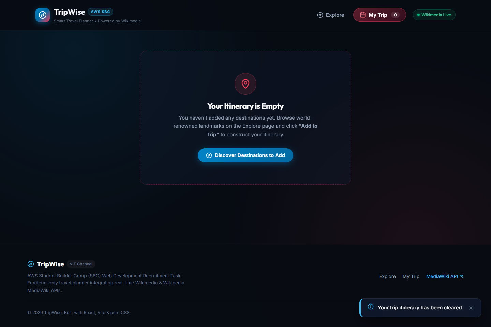
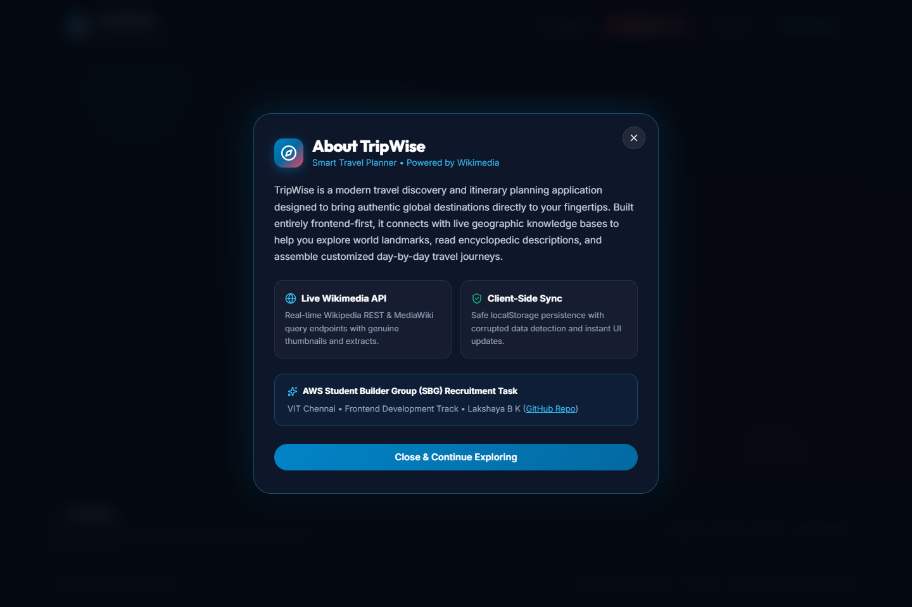
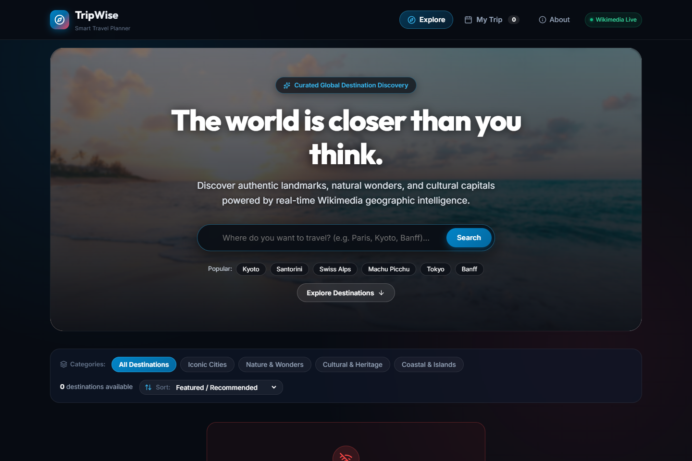

# TripWise — Smart Travel Planner

[](https://trip-wise-op.vercel.app/)
[](https://github.com/lakshaya1208/TripWise)
[](https://trip-wise-op.vercel.app/)
[](https://www.mediawiki.org/wiki/API:Main_page)

---

## 🌐 Live Deployment & Links

- **Live Deployed Application:** [https://trip-wise-op.vercel.app/](https://trip-wise-op.vercel.app/)
- **Public GitHub Repository:** [https://github.com/lakshaya1208/TripWise](https://github.com/lakshaya1208/TripWise)
- **Submission Screenshots PDF:** [`TripWise_Submission_Screenshots.pdf`](./TripWise_Submission_Screenshots.pdf)

---

## 📋 Project Overview

Planning travel often forces users to juggle multiple browser tabs to research destinations, compare landmarks, and organize itineraries. 

**TripWise** simplifies this into a unified, responsive client-side application. It allows travelers to:
1. Explore verified destinations globally using live encyclopedic data.
2. Search and discover places with an instant, debounced autocomplete search dropdown.
3. Inspect rich destination details, coordinates, and extracts.
4. Curate an organized, day-by-day personal itinerary with custom notes.
5. Persist trips reliably in the browser with corrupted-data protection.

---

## 🎯 Chosen Track & Submission Details

- **Organization:** AWS Student Builder Group (SBG), VIT Chennai
- **Task:** Web Development Recruitment Task
- **Chosen Track:** **Track 1: Frontend Development**
- **Applicant:** Lakshaya B K (`lakshaya1208`)
- **Institution:** VIT Chennai

---

## 🛠️ Technologies Used

| Layer | Technologies |
|---|---|
| **Core Framework** | React 19, JavaScript (ESNext, JSX) |
| **Build Tool & Dev Server** | Vite 8 |
| **Styling & Design System** | Vanilla CSS with CSS Custom Properties (Design Tokens), Flexbox, CSS Grid, Glassmorphism |
| **Typography** | Google Fonts (`Outfit` for headings, `Inter` for body) |
| **Icons** | Lucide React |
| **Client Storage** | Browser `localStorage` with JSON schema validation & fallback protection |
| **Automated Verification** | Puppeteer Core with headless Chrome |
| **Deployment Platform** | Vercel |

---

## 🌍 External API Details

TripWise uses **100% genuine, live Wikimedia & Wikipedia public MediaWiki APIs** (CORS-enabled via `origin=*`, requiring no secret keys or backend proxy):

1. **Wikimedia Prefixsearch API (`action=query&generator=prefixsearch`):**
   - **Endpoint:** `https://en.wikipedia.org/w/api.php?action=query&generator=prefixsearch&gpssearch={query}&gpslimit=8&prop=pageimages|description|extracts&piprop=thumbnail&pithumbsize=160&format=json&origin=*`
   - **Data Provided:** Live destination suggestions with title matching, short location descriptions, thumbnail images, and extract previews.
   - **Usage in TripWise:** Powers the debounced autocomplete search dropdown beneath the search input.

2. **Wikipedia REST API Summary Endpoint (`/api/rest_v1/page/summary/{title}`):**
   - **Endpoint:** `https://en.wikipedia.org/api/rest_v1/page/summary/{title}`
   - **Data Provided:** High-resolution destination photography/thumbnails, geographic coordinates (`lat`/`lon`), full encyclopedic synopsis (`extract`), and canonical Wikipedia URLs.
   - **Usage in TripWise:** Powers the Destination Details modal and curated category exploration.

3. **Wikimedia Action Search API (`action=query&generator=search`):**
   - **Endpoint:** `https://en.wikipedia.org/w/api.php?action=query&generator=search&gsrsearch={query}...`
   - **Data Provided:** Full text search across worldwide places and geographic landmarks.

---

## ✨ Key Features

- **Photography-Led Discovery Hero:** Full-width scenic travel photography with calibrated translucent dark overlays ensuring readability.
- **Real-Time Autocomplete Search Dropdown:** Debounced query requests, thumbnail previews, match highlighting, loading indicator, and full keyboard navigation (`Arrow Down`, `Arrow Up`, `Enter`, `Escape`).
- **Category Filtering & Sorting:** Filter by *All Destinations, Iconic Cities, Nature & Wonders, Cultural & Heritage, Coastal & Islands* and sort by *Featured*, *Name (A–Z / Z–A)*, *Article Depth*, or *Latitude*.
- **Destination Details Modal:** Detailed view with high-res photography, geographic coordinates, classification badges, encyclopedic descriptions, Wikipedia links, and duplicate-safe "Add to My Trip" action.
- **Organized Itinerary Management:** Day-by-day sequencing (Day 1, Day 2...), Move Up/Down reordering, inline custom travel notes, stop counters, country metrics, and plain-text export.
- **Reliable Storage Persistence:** Automatically syncs with browser `localStorage`, with error handling to discard corrupted records and restore clean state on page refresh.
- **Feedback & Error Handling:** Shimmer loading skeletons, network failure screens with a live **Retry** button, empty search states, and image fallbacks.
- **Fully Responsive:** Tested across mobile (375px & 390px), tablet (768px), and desktop (1024px+), including reduced-motion accessibility support.

---

## 📸 Application Previews

### 1. Photography-Led Discovery Homepage


### 2. Real-Time Autocomplete Search Dropdown


### 3. Destination Details Modal


### 4. My Trip Itinerary Planner


### 5. Contextual Empty State


### 6. About Modal & Project Attribution


### 7. Mobile Viewport (iPhone 14 / 390px)
<p align="center">
  
</p>

### 8. Error & Live Retry State


---

## 🚀 Setup & Run Instructions

### Prerequisites
- **Node.js:** `v18.0.0` or higher (tested on `v24.20.0`)
- **npm:** `v9.0.0` or higher

### 1. Clone & Install

```bash
# Clone the repository
git clone https://github.com/lakshaya1208/TripWise.git
cd TripWise

# Install dependencies
npm install
```

### 2. Run Locally in Development

```bash
npm run dev
```

Open [http://localhost:5173/](http://localhost:5173/) in your browser.

### 3. Build for Production

```bash
# Compile and bundle
npm run build

# Preview production build locally
npm run preview
```
