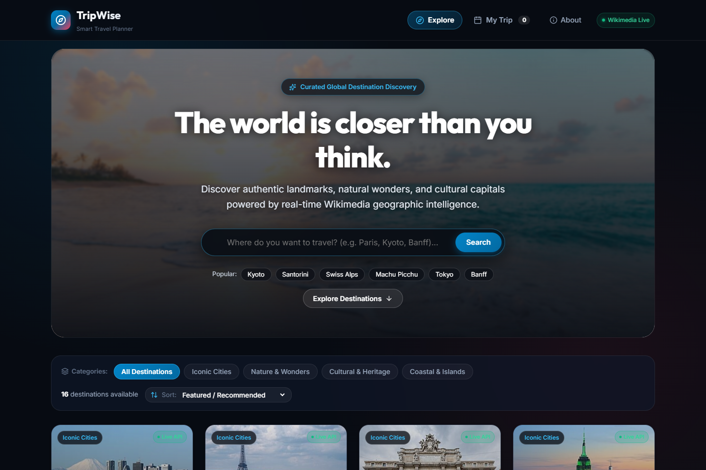
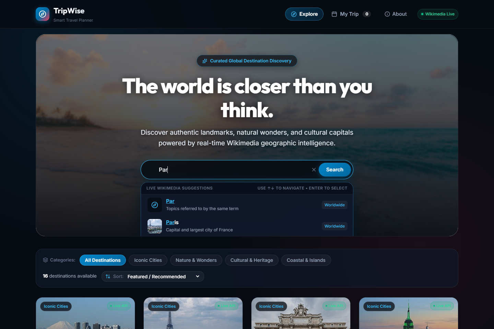
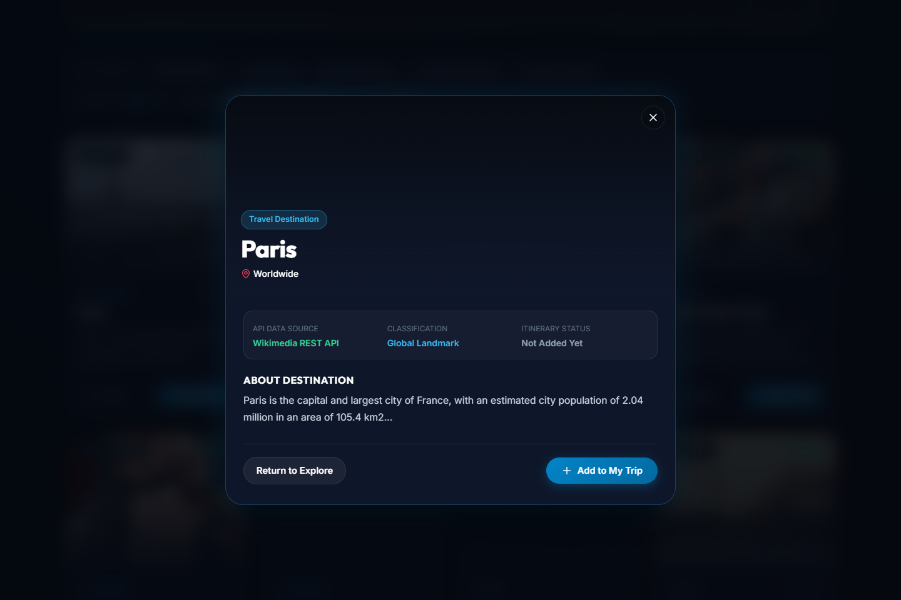
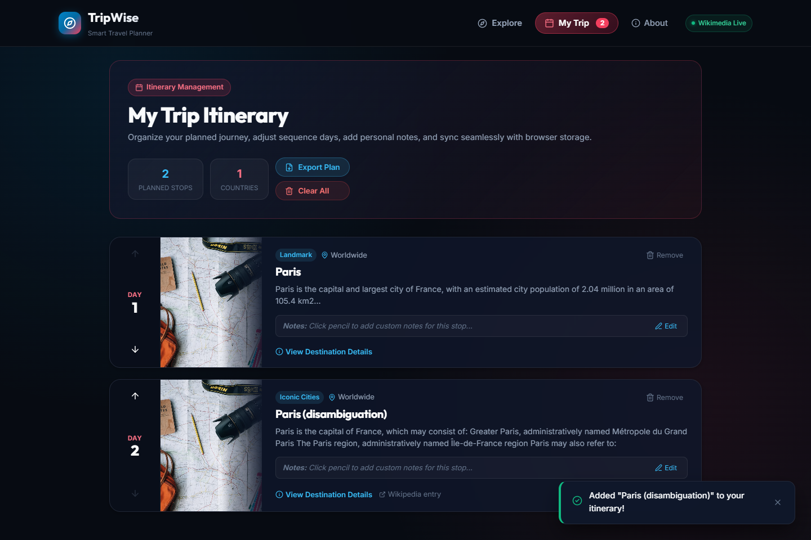
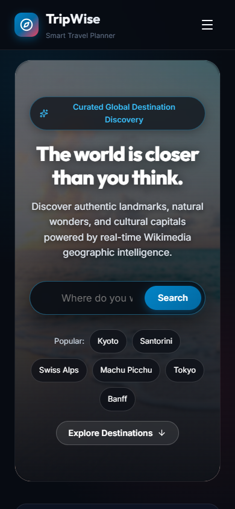

# TripWise — Smart Travel Planner

TripWise is a modern, responsive web application designed to simplify the fragmented travel planning experience. Instead of juggling dozens of tabs to research destinations, compare landmarks, and organize itineraries, TripWise consolidates global discovery and day-by-day trip planning into a single, intuitive interface powered by authentic, real-time geographic data.

---

## Key Features

- **Photography-Led Destination Discovery:** Explore curated iconic cities, natural wonders, cultural heritage sites, and coastal escapes featuring authentic photography and dark overlay treatments.
- **Real-Time Autocomplete Search:** Instant debounced search suggestions populated from live Wikimedia endpoints with thumbnail previews, location descriptions, highlighted match queries, and full keyboard navigation (Arrow Up/Down, Enter, Escape).
- **Multi-Criteria Filtering & Sorting:** Narrow down places by category (*Iconic Cities, Nature & Wonders, Cultural & Heritage, Coastal & Islands*) and sort by *Featured*, *Alphabetical (A–Z / Z–A)*, *Article Depth*, or *Geographic Latitude*.
- **Rich Destination Details:** In-depth modal with geographic coordinates, classification badges, original encyclopedic extracts, and direct links to Wikipedia source articles.
- **Organized Itinerary Management:** Save destinations, reorder stops chronologically (Day 1, Day 2...), annotate with custom inline notes, track stops and countries, or export plans as formatted text files.
- **Safe Browser Persistence:** Automatic `localStorage` synchronization with schema validation and corrupted-data safety guards, ensuring trips remain intact across page reloads.
- **Resilient UI States:** Responsive loading skeletons, network error screens with live retry triggers, empty search fallbacks, and image fallbacks.

---

## Application Previews

### 1. Photography-Led Homepage & Destination Discovery


### 2. Live Autocomplete Search Dropdown


### 3. Destination Details Modal


### 4. My Trip Itinerary Planner


### 5. Mobile Responsive View (iPhone 14 Viewport)
<p align="center">
  
</p>

*Complete multi-page submission PDF: [`TripWise_Submission_Screenshots.pdf`](./TripWise_Submission_Screenshots.pdf)*

---

## Technology Stack

- **Frontend Core:** React 19, JavaScript (ESNext, JSX)
- **Tooling & Bundler:** Vite 8
- **Styling:** Vanilla CSS with CSS Custom Properties (Design Tokens), Flexbox, CSS Grid, Glassmorphism, and responsive breakpoints
- **Icons:** Lucide React
- **Storage:** Browser `localStorage` with fail-safe schema verification
- **Testing & Screenshot Automation:** Puppeteer Core + Headless Google Chrome

---

## External API Integration

TripWise connects directly to genuine **Wikimedia & Wikipedia Public MediaWiki APIs** (CORS-enabled via `origin=*`, requiring no exposed API keys or secrets):

1. **Wikimedia Prefixsearch API (`action=query&generator=prefixsearch`):**
   - **Endpoint:** `https://en.wikipedia.org/w/api.php?action=query&generator=prefixsearch...`
   - **Data Provided:** Live destination autocomplete suggestions with page titles, descriptions, extract snippets, and thumbnail image URLs.

2. **Wikipedia REST API Summary Endpoint (`/api/rest_v1/page/summary/{title}`):**
   - **Endpoint:** `https://en.wikipedia.org/api/rest_v1/page/summary/{title}`
   - **Data Provided:** Comprehensive destination metadata including official titles, high-resolution original images/thumbnails, geographic coordinates (latitude and longitude), article extracts, and desktop Wikipedia URLs.

3. **Wikimedia Action Search API (`action=query&generator=search`):**
   - **Endpoint:** `https://en.wikipedia.org/w/api.php?action=query&generator=search...`
   - **Data Provided:** Real-time global text search across worldwide places and geographic landmarks.

---

## Project Context

This application was developed as a submission for the **Web Development Recruitment Task** for the **AWS Student Builder Group (SBG), VIT Chennai** under **Track 1: Frontend Development**.

- **Applicant:** Lakshaya B K (`lakshaya1208`)
- **Institution:** VIT Chennai
- **Repository:** [https://github.com/lakshaya1208/TripWise](https://github.com/lakshaya1208/TripWise)

---

## Run Locally

### Prerequisites
- Node.js `18.0.0` or higher
- npm `9.0.0` or higher

### Steps

```bash
# 1. Clone repository
git clone https://github.com/lakshaya1208/TripWise.git
cd TripWise

# 2. Install dependencies
npm install

# 3. Start development server
npm run dev
```

Visit `http://localhost:5173/` in your browser.

### Production Build

```bash
npm run build
npm run preview
```
